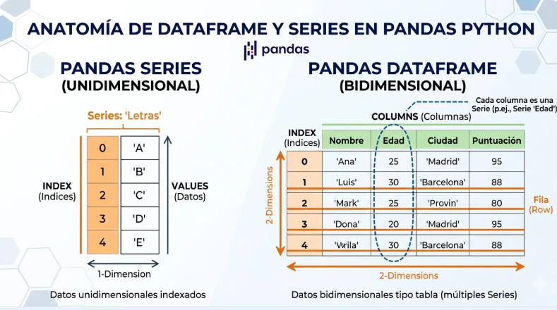
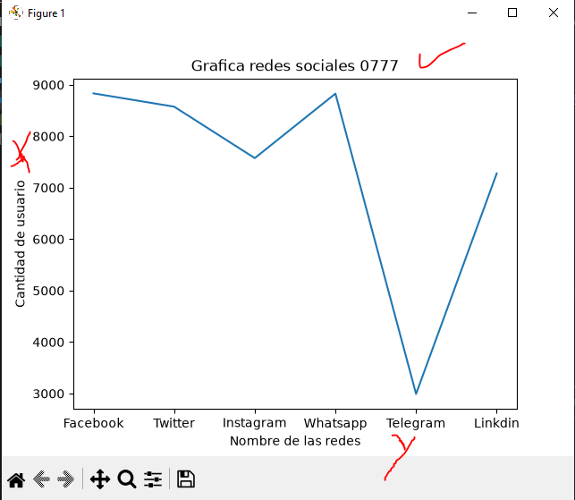
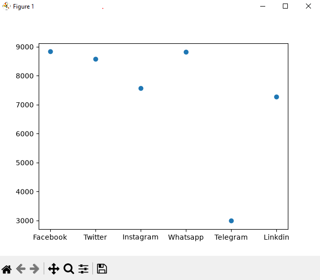
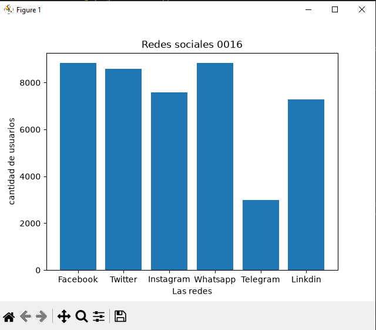
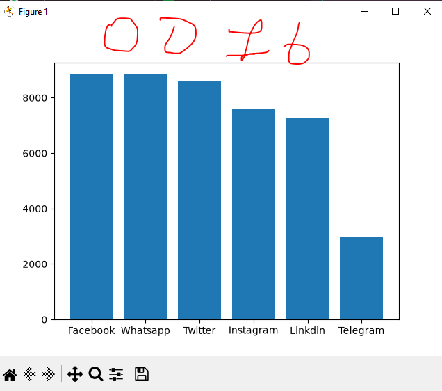
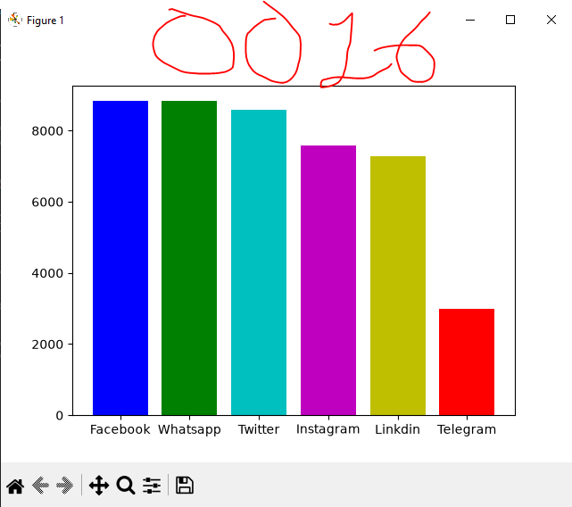
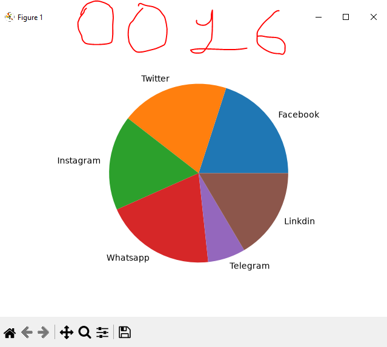

## Data Frame o marco de datos personales 

## Redes sociales a nivel mundial

## Grafica lineal de redes sociales 

## Grafica de puntos de redes sociales

# Grafica de barras

## Grafica de barras ordenadas

## Grafica de barras con coloor

## Grafica de pastel o pie
